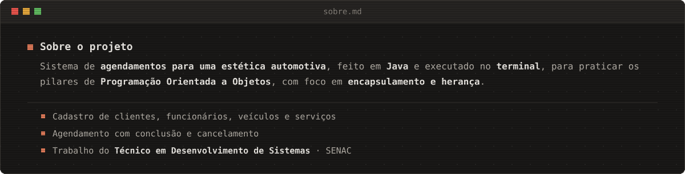

## Funcionalidades

- Cadastro de clientes, funcionários, veículos e serviços
- Agendamento de serviços, com conclusão e cancelamento
- Listagens de clientes, funcionários, veículos, serviços e agendamentos
- Busca de clientes e veículos
- Remoção de cadastros

## Modelagem

| Classe | Papel |
| --- | --- |
| `Pessoa` | Classe pai com os dados comuns |
| `Cliente` e `Funcionario` | Classes filhas de `Pessoa` (herança) |
| `Veiculo`, `Servico` e `Agendamento` | Entidades do domínio |
| `Gerenciamento` | Regras de negócio e menus do sistema |
| `App` | Ponto de entrada, com dados de exemplo para teste |

Os atributos ficam privados e são acessados por getters e setters (encapsulamento).

## Como executar

Com o JDK instalado, na raiz do projeto:

```bash
javac -d bin src/*.java
java -cp bin App
```
