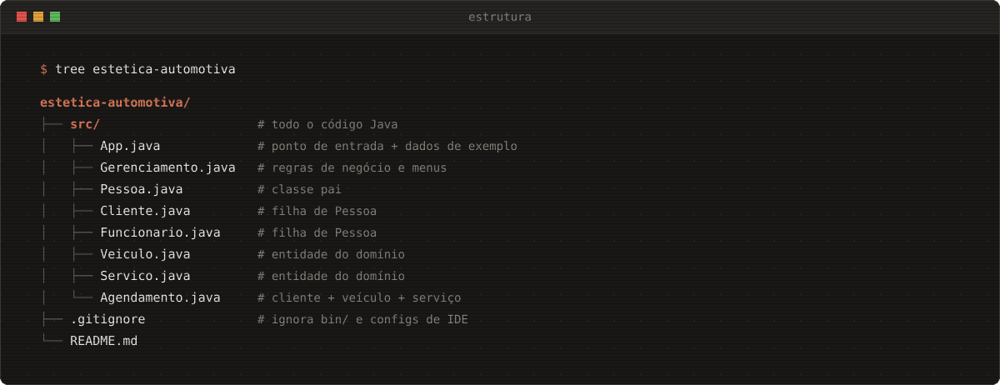

| Classe | Papel |
| --- | --- |
| [`Pessoa`](src/Pessoa.java) | Classe pai com os dados comuns |
| [`Cliente`](src/Cliente.java) e [`Funcionario`](src/Funcionario.java) | Classes filhas de `Pessoa` (herança) |
| [`Veiculo`](src/Veiculo.java), [`Servico`](src/Servico.java) e [`Agendamento`](src/Agendamento.java) | Entidades do domínio |
| [`Gerenciamento`](src/Gerenciamento.java) | Regras de negócio e menus do sistema |
| [`App`](src/App.java) | Ponto de entrada, com dados de exemplo para teste |

Os atributos ficam privados e são acessados por getters e setters (encapsulamento).



Com o JDK instalado, na raiz do projeto:

```bash
javac -d bin src/*.java
java -cp bin App
```

O sistema abre um menu no terminal. O `App` já carrega alguns dados de exemplo para você testar os cadastros, as listagens e os agendamentos sem começar do zero.

<a href="https://github.com/GabrielCardossso"></a>
